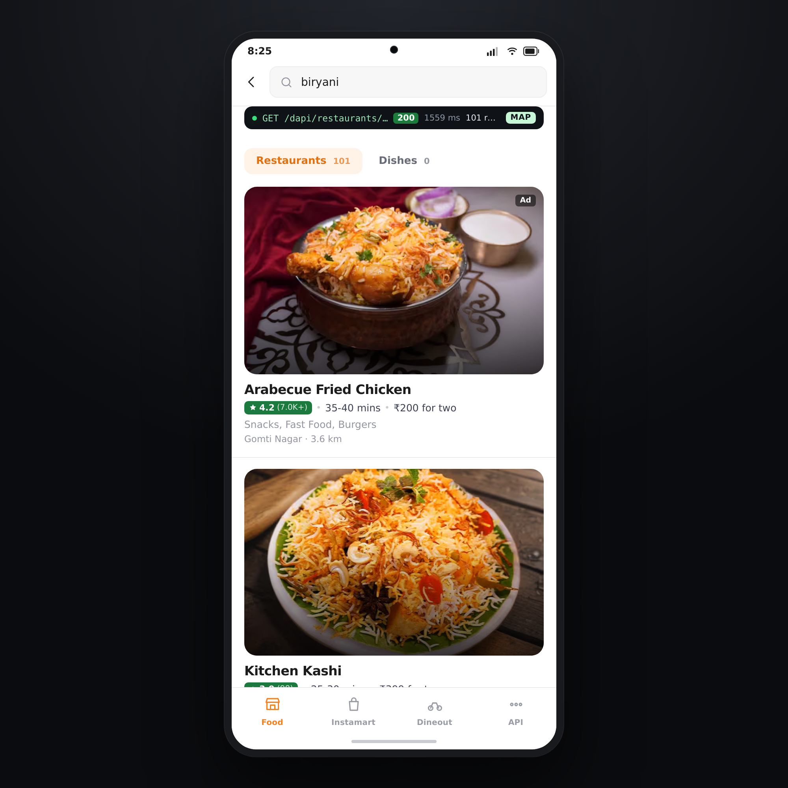
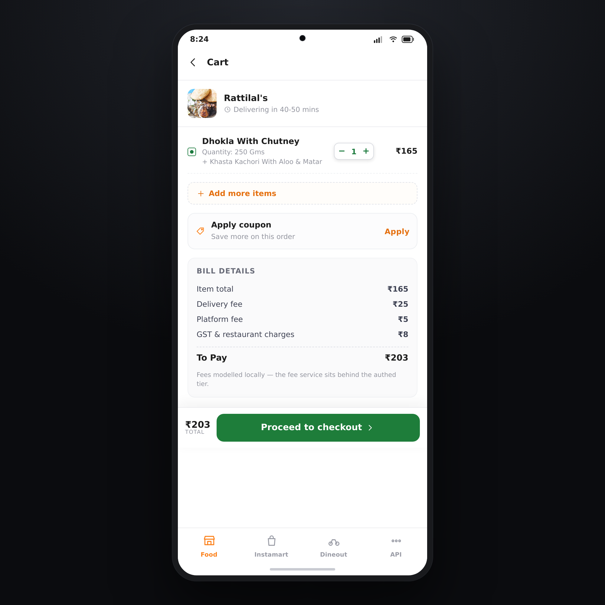
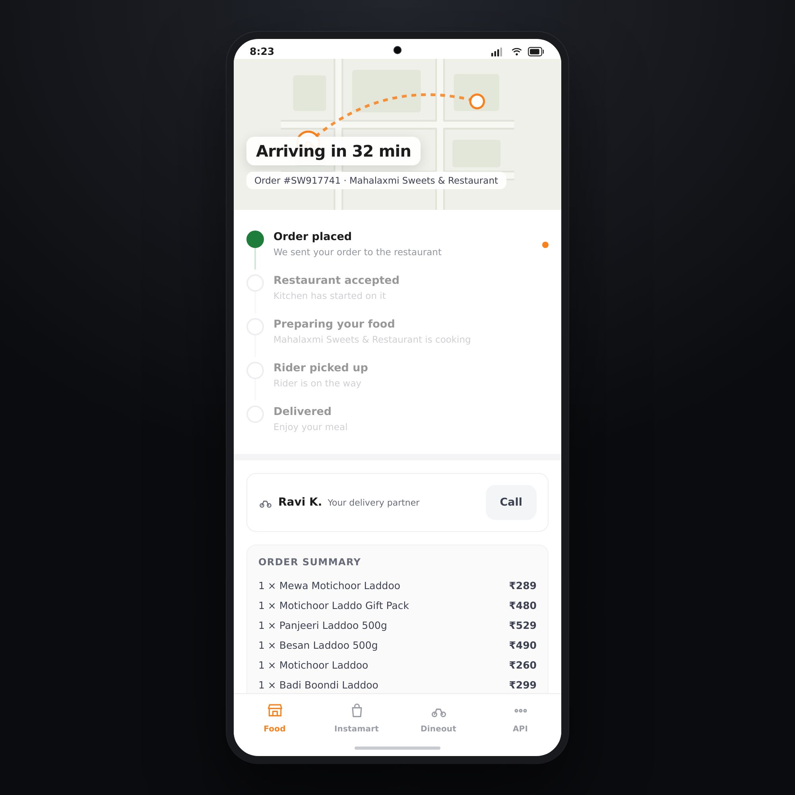

# swiggy-live

**The Swiggy Android app, rebuilt as a web app on the app's own endpoints** — reverse-engineered by probing its network surface, not from docs, not from a wrapper, not scraped out of a browser session.

Real restaurants, real menus, real prices, real images, real ETAs. Lucknow by default; anywhere you point `lat/lng`.

| Home | Menu | Item sheet |
|---|---|---|
|  |  |  |

| Search | Cart | Tracking | Endpoint map |
|---|---|---|---|
|  |  |  |  |

```bash
git clone <this repo> && cd swiggy-live
node server.js          # http://localhost:3000
```

No dependencies. Node 18+.

---

## 1. What you're looking at

| Piece | What it does |
|---|---|
| `server.js` | Static host + edge proxy to `www.swiggy.com` + normalizers + `/api/map` |
| `public/js/core.js` | State, router, cart engine, fetch layer |
| `public/js/views.js` | Every screen: home, search, menu, cart, checkout, tracking, endpoint console |
| `public/js/art.js` | Procedural SVG art — image fallbacks and all UI icons. No icon font, no CDN |
| `public/js/data.js` | Offline demo catalog, used only when the proxy can't reach the edge |
| `tools/probe.sh` | Re-runs the discovery. Same numbers, every box |

The browser never talks to Swiggy. It talks to `/api/*` on this box; this box talks to `www.swiggy.com` and slims the protobuf-JSON down to view models (132 KB listing → ~20 KB; 134 KB menu → structured sections).

---

## 2. The endpoint map

Everything below was found by probing, and every row is verified — run `tools/probe.sh`.

```
route                      code bytes    secs
------------------------------------------------------------------
list/v5 (dapi)             200 132403 1.195275
search/v3 RESTAURANT       200 235507 1.556490
search/v3 DISH             200 329398 2.019816
menu/pl (dapi)             202 0      0.051300     <- challenged
menu/pl (mapi)             200 134621 0.788840     <- same route, mobile prefix
search/suggest             200 14146  0.328543
instamart/home             202 0      0.029862     <- challenged
dineout/v2/home            404 4082   0.263609

control — same route with a non-browser UA:
list/v5 (curl UA)          403 4063   0.753081
```

### The gate

Two headers are the whole difference between `200` and a `202` with an empty body:

```
User-Agent: Mozilla/5.0 (Windows NT 10.0; Win64; x64) AppleWebKit/537.36 (KHTML, like Gecko) Chrome/124.0.0.0 Safari/537.36
__fetch_request: 1
```

A bare `curl` UA gets `403`. A browser UA without `__fetch_request` gets `202`. Both together and the food vertical falls open. This is why the proxy sets an explicit header set instead of forwarding whatever the browser sent.

### Routes that carry the app

**Home feed**
```
GET /dapi/restaurants/list/v5
    ?lat=<f>&lng=<f>&is-seo-homepage-enabled=true&page_type=DESKTOP_WEB_LISTING
```
12 cards: `GridWidget` category chips ("What's on your mind?"), "Top restaurant chains", the restaurant grid, `BrandsContent` SEO blocks, footer. Restaurant objects sit under `card.card.gridElements` with `@type …food.v2.Restaurant`.

**Search — two different result shapes on one route**
```
GET /dapi/restaurants/search/v3
    ?lat&lng&str=<query>&trackingId=undefined&submitAction=ENTER
    &queryUniqueId=<uuid4>&selectedPLTab=RESTAURANT|DISH
```
`RESTAURANT` → flat list of `Restaurant` objects (~73–101 per query).
`DISH` → 50ish `DishGroup` cards, each carrying `restaurant.info` plus `dishes[].info`. That nesting is the only way a dish result knows which kitchen sells it.

**Menu**
```
GET /mapi/menu/pl
    ?page-type=REGULAR_MENU&complete-menu=true&lat&lng&restaurantId&submitAction=ENTER
```
The `/dapi/menu/pl` variant of the *same* route answers `202`. Only `/mapi/` passes. Menu body hangs off `data.cards[n].groupedCard.cardGroupMap.REGULAR.cards` — note that node carries **no** `@type`, so a type-based walk misses it entirely.

Inside: `ItemCategory` (title + `itemCards`) and `NestedItemCategory` (sub-categories, e.g. "Tea & Coffee" → "Tea" / "Coffee"). Each dish has `price` in **paise**, `variants.variantGroups` (portion sizes with price deltas), and `addons` groups (`maxAddons`, per-choice prices).

**Autosuggest**
```
GET /dapi/restaurants/search/suggest?lat&lng&str
```

**Images**
```
GET https://media-assets.swiggy.com/swiggy/image/upload/fl_lossy,f_auto,q_auto,w_508,h_320,c_fill/<cloudinaryImageId>
```
`cloudinaryImageId` comes straight off any card, restaurant, or dish object.

### Routes that don't open

| Route | Status | Why |
|---|---|---|
| `POST /dapi/restaurants/list/update` | 202 | Pagination. Akamai sensor challenge. Worked around by paging through `/search`, which returns ~100 rows per call. |
| `GET /api/instamart/home` | 202 | Instamart storefront needs valid `_abck` / `bm_sz` cookies minted by the sensor script, or attested device headers. |
| `GET /dapi/instamart/search/v2` | 403 | Same gate. |
| `/dapi/dineout/v2/home`, `/mapi/dineout/v2/home` | 404 | Prefix unknown. Not a challenge — the path simply doesn't exist there. Would need the Dineout tab's actual route out of an APK bundle. |
| `POST /dapi/cart/add`, `/dapi/order/place` | 401 | Transactional tier: `Authorization: Bearer <jwt>` from OTP login + `_device_id` + cart token cookies. |

---

## 3. What is real and what is modelled

**Real, straight off the API:** restaurant list, categories, names, cuisines, ratings, rating counts, ETAs, distances, cost-for-two, offers, open/closed state, menus, categories, dish names, descriptions, prices, portion variants with price deltas, add-on groups, veg/non-veg flags, bestseller ribbons, per-dish ratings, dish and restaurant imagery, and search across both.

**Modelled locally, on purpose:**

- **Cart, bill, checkout, tracking.** The cart endpoints sit behind the authed tier. Rather than fake an OTP flow or replay someone's session, the cart is local and priced off live menu data. Delivery/platform/GST lines are modelled with a `199` free-delivery threshold; the bill says so on screen.
- **Order placement.** No order is sent anywhere. Placing one creates a local order object with a simulated rider timeline.
- **Instamart and Dineout.** Deliberately not faked. Both tabs show the actual probe result and what it would take to open them.

Nothing here logs into an account, places an order, or touches payment. It reads public catalog data and renders it.

---

## 4. Screens

- **Home** — location switcher (four real Lucknow coordinates, re-queries the listing), live category chips, restaurant grid with offer strips and rating chips, veg filter.
- **Search** — debounced live query, Restaurants/Dishes tabs, dish cards carrying their restaurant.
- **Menu** — hero, rating/ETA/cost badges, category rail with scroll-spy, veg mode, `ADD` vs `customisable` (variants/addons open the sheet), item sheet with portion radios, add-on checkboxes, live unit price.
- **Cart** — single-restaurant rule enforced with the real "start a new cart" prompt, quantity steppers, coupons (`WELCOME50`, `TRYNEW`, `SWIGGYIT`, `FREEDEL`) with min-order checks, itemised bill.
- **Checkout** — address, instructions, tip, payment method, bill summary.
- **Tracking** — animated map, step timeline on real elapsed time, rider card, order summary.
- **API** — the endpoint map above, in-app, with a **Run live probe** button per row that fires the request through the proxy and prints code / bytes / ms.

---

## 5. Notes for the next pass

- `/dapi/restaurants/list/update` would unlock true infinite scroll. It needs the sensor challenge cleared, which means a real browser context (Playwright with the site's own JS) or the app's attested headers.
- Dineout/Instamart prefixes: pull the React Native bundle out of the APK (`assets/index.android.bundle`) and grep for `/dapi/` and `/api/` strings. Route strings ship readable in RN builds.
- Money helper: `price` and `defaultPrice` are paise; everything above `normDish` is rupees.
- Cache TTL is 120s. `CACHE_TTL=0` disables it.
